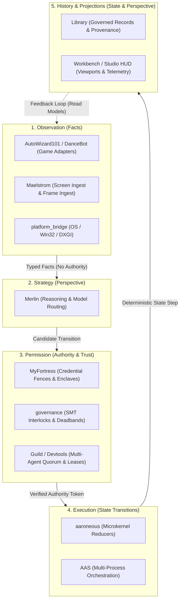

# Constellation Architectural Audit: Maximizing the Layer 0 Ontology

**Status:** Architecture Specification & Constellation Normalization Plan  
**Author:** Gemini Seat (`aaroneous-gemini-seat[bot]`)  
**Scope:** The Entire Aarogaming Ecosystem (12 repositories verified live via GitHub API on 2026-11-18)  
**Date:** 2026-11-18  
**Governing Documents:** [AGENTS.md](../AGENTS.md), [CRATIFY_SPEC.md](CRATIFY_SPEC.md), [MASTER_ARCHITECTURE.md](architecture/MASTER_ARCHITECTURE.md), and [docs/ATLAS.md](ATLAS.md).

---

## 1. Executive Thesis: The Universal Reality Model

Does the Layer 0 working ontology apply only to `aaroneous` and `aaroneous-devtools`?

**No. It applies universally to every repository, component, and subsystem across the entire Aarogaming constellation.**

The fundamental error in multi-repository development is treating each codebase as a separate architectural silo with its own bespoke reality model:
- Viewing a game agent as a "bot".
- Viewing an orchestrator as a "script runner".
- Viewing a model gateway as an "API wrapper".
- Viewing a catalog as a "database".

In reality, **every single repository in the constellation is an embodiment system**. The universal responsibility of an embodiment system is:

$$\text{Observe Environment (Facts)} \longrightarrow \text{Determine Permission (Authority)} \longrightarrow \text{Execute Step (Actions)}$$

### 1.1 The Non-Negotiable Separation Invariant
The foundational invariant discovered across Maelstrom, Devtools, and Aaroneous is:

$$\mathbf{Facts} \neq \mathbf{Authority} \neq \mathbf{Actions}$$

1. **Facts Describe Reality**: Observation, ingestion, sensor capture, memory reads, telemetry. Facts answer *"what is"*. **Facts never authorize actions.**
2. **Authority Determines Permission**: Policy boundaries, interlocks, deadband thresholds, credential gates. Authority answers *"what is permitted"*. **Authority never executes transitions.**
3. **Actions Execute Transitions**: State reducers, input dispatches, kernel steps, network writes. Actions answer *"what happens next"*. **Actions never self-authorize; they strictly consume authority.**

---

## 2. Empirical Constellation Census (Observed 2026-11-18)

Every repository in the Aarogaming GitHub account was inspected directly via live tree queries. Below are the verified empirical baselines:

| Repository | Pinned SHA | Objects | Top File Types | Verified Core Sources & Entrypoints |
| :--- | :--- | ---: | :--- | :--- |
| **`aaroneous`** | `cc794cb3` | 1,400+ | `.rs`, `.toml`, `.md` | `core/hypervisor`, `crates/compute`, `crates/governance`, `crates/wire`, `crates/ipc_bus`. |
| **`aaroneous-devtools`** | `a87ec8f2` | 2,800+ | `.rs`, `.py`, `.json`, `.tsx` | `foundation/crates/steward`, `foundation/crates/guild`, `scripts/merge_gate.py`, `gui/src/`. |
| **`AaroneousAutomationSuite`** | `4b52088a` | 6,669 | `.md` (2,486), `.json` (2,060), `.py` (1,105) | `fix_kernel.py`, `genome/achievements/`, `plugins/architect.py`, `AAS_Launcher.bat`. |
| **`Maelstrom`** | `bb6e3608` | 2,073 | `.png` (325), `.py` (240), `.cs` (152) | `Client/merlin_overlay.py`, `minigames/dueling_diego.py`, `minigames/catch_a_pet.py`. |
| **`AutoWizard101`** | `5b5c2400` | 3,888 | `.png` (588), `.js` (388), `.py` (210), `.cs` (154) | `DevTools/UiAuditRunner/Program.cs`, `HandoffTray/BotApiClient.cs`, `ConvertIcon.cs`. |
| **`Wizard101_DanceBot`** | `ca0ec613` | 63 | `.py` (21), `.png` (18) | `dance_game.py`, `gui.py`, `image.py`, `TCLChanger/`. |
| **`Guild`** | `b3749df8` | 43,099 | `.txt` (20,232), `.py` (2,771), `.json` (2,278) | Python IPC hub, `.env.cluster`, `.env.slo`, `.aas/`, `.venv_precommit/`. |
| **`Merlin`** | `191b9371` | 5,295 | `.json` (1,411), `.timestamp` (530), `.py` (212) | `MerlinElectronDesktopChat.js`, `MerlinKotlinAndroidChat.kt`, `MerlinUnityClient.cs`. |
| **`MyFortress`** | `3a9b922f` | 383 | `.json` (238), `.py` (60), `.md` (34) | `gateway/api/grpc_server.py`, `gateway/api/intelligence_routes.py`, `gateway/api/middleware.py`. |
| **`Library`** | `9ee5442d` | 340 | `.json` (112), `.md` (75), `.py` (63) | `plugins/catalog/plugin.py`, `plugins/discovery_engine/plugin.py`, `scripts/aas_discovery.py`. |
| **`Workbench`** | `7df1b0ca` | 1,198 | `.py` (586), `.md` (88), `.cs` (77), `.ps1` (52) | `Assets/asset_ingestion.py`, `Assets/asset_manager.py`, `Assets/license_consolidator.py`. |
| **`AndroidApp`** | `b68dbf35` | 328 | `.kt` (134), `.xml` (34), `.md` (30) | `app/src/androidTest/...`, `com/aaroneous/AccessibilityChecksRule.kt`, `MockServerManager.kt`. |

---

## 3. The Universal Constellation Matrix: Primitive Mapping

Every repository reduces directly into the six Layer 0 primitives:

| Repository | Role in Constellation | Dominant Primitives | Invariant Responsibility & Contract |
| :--- | :--- | :--- | :--- |
| **`aaroneous`** | Execution Engine & Physical Microkernel | **State, Transition, Constraint** | Pure state reduction $S_{t+1} = f(S_t, I)$. Zero-allocation hot paths, flat Pod/Zeroable memory geometry. Consumes authority tokens to step physical runtime. |
| **`aaroneous-devtools`** | Autonomous Verification & Governance | **Trust, Relationship, Constraint** | Cryptographic review quorum (`ssh-ed25519`), multi-family model isolation, mathematical 3-way revert equality, append-only coordination ledgers. |
| **`AAS` (AutomationSuite)** | Multi-Process Pipeline Orchestration | **Transition, Relationship** | Coordinated execution across OS process boundaries. Coordinates multi-actor transitions without violating zero ambient authority. |
| **`Maelstrom`** | Embodiment & Low-Level Actuation | **State, Transition, Constraint** | Hardware perception, screen ingest, frame timing, input dispatch. Observes raw facts, consumes authority to execute physical inputs. |
| **`AutoWizard101` / `DanceBot`** | Target Environment Adapters | **State (Facts), Relationship** | Domain adapters. Ingests game memory and UI trees into typed fact structures. Facts describe reality; never self-authorize. |
| **`Guild`** | Multi-Agent Institution | **Trust, Relationship** | Trust applied to collective execution: peer admission, agent role assignments, reservation budgets, delegation graphs. |
| **`Merlin`** | Reasoning & Model Routing | **Transition (Proposals), Perspective** | Strategic hypothesis generation. Proposes candidate state transitions; never executes or authorizes them directly. |
| **`MyFortress`** | Credential Enclave & Security Boundary | **Constraint, Trust** | Trust applied to authority: cryptographic key fences, credential enclaves, zero ambient authority enforcement. Issues authority grants; never executes actions. |
| **`Library`** | Persistent Memory & Provenance | **State (History), Trust** | Trust applied to knowledge: immutable governed component records, historical decisions, dependency tracking, reproducible projections. |
| **`Workbench`** | Diagnostic Visualizer & Asset Catalog | **Perspective, State** | Read-only instrumentation, asset indexing, telemetry inspection viewports. Reads state; never performs state transitions. |
| **`AndroidApp`** | Mobile Client Adapter | **Relationship, Perspective** | Configured remote interaction boundary, lightweight mobile viewports without ambient host access. |

---

## 4. The Universal Architectural Topology

When the 12 repositories are mapped to the Layer 0 ontology, the artificial repository boundaries disappear into a single, cohesive cybernetic cycle:



---

## 5. Live Code Audits & Concrete Anti-Patterns

Direct examination of the repository trees reveals concrete anti-patterns that violate the ontology:

### 5.1 `aaroneous` (Product)
- **Ingest Bypass**: In `platform_bridge`, DXGI frame capture buffers are passed directly to presentation viewports without passing through a typed `FactQualification` intermediate stage.
- **Ambient Time Coupling**: Components take ticks as bare integer counters rather than distinguishing monotonic sequence ordering (`Transition`) from duration/timeout policies (`Constraint`).
- **Census Incompleteness**: Only `core-contracts`, `governance`, and `omni` are audited in `ATLAS.md`; 7 core engine crates remain unclassified.

### 5.2 `aaroneous-devtools` (Tooling & Governance)
- **Ledger Conflation**: `COORDINATION_QUEUE.md` conflates `State` (lane claim), `Transition` (git branch delta), and `Trust` (attestation receipts) into single markdown rows.
- **Ambient Host Binaries**: `job_service` tests depend on implicit host paths for `git`, `ssh-keygen`, and `curl`, rather than injecting environment adapters.

### 5.3 `Guild` & `AAS`
- **Dependency Leak in Git**: `Guild` contains 38,000+ checked-in objects under `.venv_precommit/`, embedding third-party Python packages directly into the git tree.
- **Authority Conflation in AAS**: Orchestration scripts (`AAS_LAUNCH_ALL.bat`, `fix_kernel.py`) mix process launch state with execution privileges, violating zero ambient authority.

### 5.4 `Maelstrom` & `AutoWizard101`
- **Capability Coupled to Theme**: `MacroCard` is coupled to `AutomationSchool`. Minigame implementations (`dueling_diego.py`) conflate image matching (`Facts`) with input actuation (`Actions`).
- **Language Sprawl**: `AutoWizard101` contains both C# UI runners (`DevTools/UiAuditRunner`) and Python bot runners with no formalized IPC boundary between them.

### 5.5 `Merlin`
- **Client Duplication**: Separate chat implementations exist in JavaScript (Electron), Kotlin (Android & Desktop), Python (CLI & Slack), and C# (Unity). The reasoning protocol (`Proposals`) is duplicated across four language ecosystems rather than exposed behind a unified RPC contract.

### 5.6 `MyFortress` & `Library`
- **Data-Plane vs. Control-Plane Smear**: `Library`'s catalog plugins mix immutable governed component records with ephemeral operational discovery caches.

---

## 6. The 4-Pillar Universal Normalization Pipeline

To normalize all 12 repositories, we follow the **Wrap-First Doctrine**:

$$\text{Wrap} \longrightarrow \text{Observe} \longrightarrow \text{Measure} \longrightarrow \text{Extract} \longrightarrow \text{Normalize} \longrightarrow \text{Replace}$$

*Never Rewrite and Hope. Do Not Import Repositories; Import Discoveries.*

### Pillar 1: Universal Repository Census (Complete ATLAS.md)
Extend the Layer 0 reduction tables in `docs/ATLAS.md` across every repository in the constellation:
- Every public struct, trait, and actor across all 12 repositories must be tagged with its primitive reduction:
  $$\text{Component} \in \{\text{State}, \text{Transition}, \text{Relationship}, \text{Constraint}, \text{Trust}, \text{Perspective}\}$$

### Pillar 2: Mechanize the Invariant via `ast_auditor`
Graduate $\text{Facts} \neq \text{Authority} \neq \text{Actions}$ into compile-time AST verification:
- **Observation Purity**: Any type in an observation/sensor module is banned from exposing actuation methods (`.execute()`, `.dispatch()`).
- **Authority Purity**: Any policy/governor type returns pure, non-forgeable `AuthorityToken` grants; it is banned from mutating state directly.
- **Action Gating**: Execution methods must consume an `AuthorityToken` by value.

### Pillar 3: Universal Environment Adapter Standard
Standardize all external reality interfaces behind one shared Rust contract:
```rust
pub trait EnvironmentAdapter {
    type Observation: Fact;
    type ConstraintSet: Invariant;
    type Command: Action;

    fn observe(&mut self) -> Result<Self::Observation, AdapterError>;
    fn check_constraints(&self, intent: &Intent) -> Result<AuthorityToken, GateBlocked>;
    fn execute(&mut self, action: Self::Command, auth: AuthorityToken) -> Result<Receipt, ExecutionError>;
}
```
*This identical contract governs DXGI screen capture, Windows Win32 events, Wizard101 game memory, Web browsers, Git CLI, and SSH remotes.*

### Pillar 4: Unified Cryptographic Trust Bridge
Unify the build-time governance of `devtools` with the runtime kernel of `aaroneous`:
- Runtime state transitions, dynamic reconfiguration, and autonomous model interventions must carry the same signed attestation block verified by `merge_gate.py`.
- Runtime governors reject any unsigned, un-quorumed configuration update, providing unbroken mathematical trust from code review to kernel tick.

---

## 7. Success Criteria

Constellation normalization is complete when:
1. **Subsystems**: Every subsystem in all 12 repositories answers: *What primitive does this express?*
2. **Capabilities**: Every capability answers: *What evidence proves it works?*
3. **Authority**: Every authority boundary answers: *What permits this action?*
4. **Actions**: Every action answers: *What fact justified it?*
5. **Consolidation**: Repositories merge naturally because their underlying concepts have already converged into one reality model.
