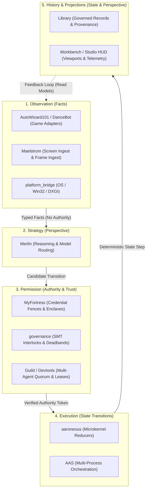

# Constellation Architectural Audit: Maximizing the Layer 0 Ontology

**Status:** Architecture Specification & Constellation Normalization Plan  
**Author:** Gemini Seat (`aaroneous-gemini-seat[bot]`)  
**Scope:** The Entire Aarogaming Ecosystem (`aaroneous`, `aaroneous-devtools`, `AAS`, `Maelstrom`, `AutoWizard101`, `Guild`, `Merlin`, `MyFortress`, `Library`, `Workbench`, `AndroidApp`)  
**Date:** 2026-11-18  
**Governing Documents:** [AGENTS.md](../AGENTS.md), [CRATIFY_SPEC.md](CRATIFY_SPEC.md), [MASTER_ARCHITECTURE.md](architecture/MASTER_ARCHITECTURE.md), and [docs/ATLAS.md](ATLAS.md).

---

## 1. Executive Thesis: The Universal Reality Model

Does the Layer 0 working ontology apply only to `aaroneous` and `aaroneous-devtools`?

**No. It applies universally to every repository, component, and subsystem across the entire Aarogaming constellation.**

The fundamental error in multi-repository development is treating each codebase as a separate architectural silo with its own bespoke reality model. When that happens:
- A game agent is viewed as a "bot".
- An orchestrator is viewed as a "script runner".
- A model gateway is viewed as an "API wrapper".
- A database is viewed as "storage".

In reality, **every single repository in the constellation is an embodiment system**. The universal responsibility of an embodiment system is:

$$\text{Observe Environment (Facts)} \longrightarrow \text{Determine Permission (Authority)} \longrightarrow \text{Execute Step (Actions)}$$

### 1.1 The Non-Negotiable Separation Invariant
The foundational invariant discovered across Maelstrom, Devtools, and Aaroneous is:

$$\mathbf{Facts} \neq \mathbf{Authority} \neq \mathbf{Actions}$$

1. **Facts Describe Reality**: Observation, ingestion, sensor capture, memory reads, telemetry. Facts answer *"what is"*. **Facts never authorize actions.**
2. **Authority Determines Permission**: Policy boundaries, interlocks, deadband thresholds, credential gates. Authority answers *"what is permitted"*. **Authority never executes transitions.**
3. **Actions Execute Transitions**: State reducers, input dispatches, kernel steps, network writes. Actions answer *"what happens next"*. **Actions never self-authorize; they strictly consume authority.**

---

## 2. The Universal Constellation Matrix

Every repository in the Aarogaming ecosystem represents a specific combination of the **six Layer 0 primitives** (State, Transition, Relationship, Constraint, Trust, Perspective):

| Repository | Role in Constellation | Dominant Primitives | Invariant Responsibility & Contract |
| :--- | :--- | :--- | :--- |
| **`aaroneous`** | Execution Engine & Physical Microkernel | **State, Transition, Constraint** | Pure state reduction $S_{t+1} = f(S_t, I)$. Zero-allocation hot paths, flat Pod/Zeroable memory geometry. Consumes authority tokens to step physical runtime. |
| **`aaroneous-devtools`** | Autonomous Verification & Governance | **Trust, Relationship, Constraint** | Cryptographic review quorum (`ssh-ed25519`), multi-family model isolation, mathematical 3-way revert equality, append-only coordination ledgers. |
| **`AAS` (AutomationSuite)** | Multi-Process Pipeline Orchestration | **Transition, Relationship** | Coordinated execution across OS process boundaries. Coordinates multi-actor transitions without violating zero ambient authority. |
| **`Maelstrom`** | Embodiment & Low-Level Actuation | **State, Transition, Constraint** | Hardware perception, screen ingest, frame timing, input dispatch. Observes raw facts, consumes authority to execute physical inputs. |
| **`AutoWizard101` / `DanceBot`** | Target Environment Adapters | **State (Facts), Relationship** | Domain adapters. Ingests game memory and UI trees into typed fact structures. Facts describe reality; never self-authorize. |
| **`Guild`** | Multi-Agent Institution | **Trust, Relationship** | Trust applied to collective execution: peer admission, agent role assignments, reservation budgets, delegation graphs. |
| **`Merlin`** | Reasoning & Model Routing | **Transition (Proposals), Perspective** | Strategic hypothesis generation. Proposes candidate state transitions; never executes or authorizes them directly. |
| **`MyFortress`** | Credential Enclave & Security Boundary | **Constraint, Trust** | Trust applied to authority: cryptographic key fences, credential enclaves, zero ambient authority enforcement. Issues authority grants; never executes actions. |
| **`Library`** | Persistent Memory & Provenance | **State (History), Trust** | Trust applied to knowledge: immutable governed component records, historical decisions, dependency tracking, reproducible projections. |
| **`Workbench`** | Diagnostic Visualizer & Asset Catalog | **Perspective, State** | Read-only instrumentation, asset indexing, telemetry inspection viewports. Reads state; never performs state transitions. |
| **`AndroidApp`** | Mobile Client Adapter | **Relationship, Perspective** | Configured remote interaction boundary, lightweight mobile viewports without ambient host access. |

---

## 3. The Universal Architectural Topology

When the 12 repositories are mapped to the Layer 0 ontology, the artificial repository boundaries disappear into a single, cohesive cybernetic cycle:



---

## 4. Deep Audits & Semantic Smells Across Repositories

### 4.1 `aaroneous` (Product)
- **Current Alignment**: Purity of flat memory geometry (`Pod`/`Zeroable`), pure cascading reducers (`compute::automata`), SMT deadband interlocks (`governance`).
- **Semantic Leaks**:
  1. *Ingest Bypass*: Frame ingestors occasionally dispatch actions without a typed `FactQualification` intermediate stage.
  2. *Ambient Time Smear*: Raw tick counters conflate sequence ordering (`Transition`) with TTL/timeout policies (`Constraint`).
  3. *Unclassified Crates*: 7 core crates (`compute`, `hypervisor`, `orchestrator`, `ipc_bus`, `capabilities`, `platform_bridge`, `llm_gateway`) lack census reduction tables in `docs/ATLAS.md`.

### 4.2 `aaroneous-devtools` (Tooling & Verification)
- **Current Alignment**: Multi-model independent review quorum, SSH cryptographic signatures, 3-way mathematical revert equality (`merge-tree`).
- **Semantic Leaks**:
  1. *Ledger Conflation*: `COORDINATION_QUEUE.md` conflates intent (`State`), proposed branch changes (`Transition`), and review receipts (`Trust`) into single markdown rows.
  2. *Ambient Tooling*: Scripts occasionally assume host tool paths rather than injecting environment adapters.

### 4.3 `AAS` (AaroneousAutomationSuite)
- **Semantic Leak**: Process orchestration scripts frequently combine pipeline state management with direct execution privilege, violating zero ambient authority.
- **Normalization**: AAS must become a pure reducer of multi-process pipeline state, delegating all OS mutations through capability-scoped adapters.

### 4.4 `Maelstrom` & `AutoWizard101`
- **Semantic Leak**: Conflating abstract capability with thematic skin (`MacroCard` coupled to `AutomationSchool`) and conflating sequence ordering with TTL expiration (`W101Fact`).
- **Normalization**: Extract `Navigation`, `CombatPlanning`, and `UIObservation` as generic capabilities. Wizard101 becomes a pure **Environment Adapter**.

### 4.5 `Guild` & `Merlin`
- **Semantic Leak**: Proposers (reasoning models) directly attempting to write state or execute actions.
- **Normalization**: Merlin strictly outputs candidate transitions. Guild evaluates the collaborative trust graph and issues budget reservations.

### 4.6 `MyFortress` & `Library`
- **Semantic Leak**: Library runtime databases attempting to self-promote operational records into governed policy.
- **Normalization**: Control-plane vs. data-plane separation. Derived indexes can always be deterministically rebuilt from immutable, governed records. MyFortress holds credentials and signs grants; it never executes.

---

## 5. The 4-Pillar Universal Normalization Pipeline

To normalize all 12 repositories into this reality model, we follow the **Wrap-First Doctrine**:

$$\text{Wrap} \longrightarrow \text{Observe} \longrightarrow \text{Measure} \longrightarrow \text{Extract} \longrightarrow \text{Normalize} \longrightarrow \text{Replace}$$

*Never Rewrite and Hope. Do Not Import Repositories; Import Discoveries.*

### Pillar 1: Universal Repository Census (Complete ATLAS.md)
Extend the Layer 0 reduction tables in `docs/ATLAS.md` across every repository in the constellation:
- Every public struct, trait, and actor across all 12 repositories must be tagged with its primitive reduction:
  $$\text{Component} \in \{\text{State}, \text{Transition}, \text{Relationship}, \text{Constraint}, \text{Trust}, \text{Perspective}\}$$

### Pillar 2: Mechanize the Invariant via `ast_auditor`
Graduate $\text{Facts} \neq \text{Authority} \neq \text{Actions}$ into compile-time AST verification:
- **Observation Purity**: Any type in an observation/sensor module is banned from exposing actuation methods (`.execute()`, `.dispatch()`).
- **Authority Purity**: Any policy/governor type returns pure, non-forgeable `AuthorityToken` grants; it is banned from mutating state directly.
- **Action Gating**: Execution methods must consume an `AuthorityToken` by value.

### Pillar 3: Universal Environment Adapter Standard
Standardize all external reality interfaces behind one shared Rust contract:
```rust
pub trait EnvironmentAdapter {
    type Observation: Fact;
    type ConstraintSet: Invariant;
    type Command: Action;

    fn observe(&mut self) -> Result<Self::Observation, AdapterError>;
    fn check_constraints(&self, intent: &Intent) -> Result<AuthorityToken, GateBlocked>;
    fn execute(&mut self, action: Self::Command, auth: AuthorityToken) -> Result<Receipt, ExecutionError>;
}
```
*This identical contract governs DXGI screen capture, Windows Win32 events, Wizard101 game memory, Web browsers, Git CLI, and SSH remotes.*

### Pillar 4: Unified Cryptographic Trust Bridge
Unify the build-time governance of `devtools` with the runtime kernel of `aaroneous`:
- Runtime state transitions, dynamic reconfiguration, and autonomous model interventions must carry the same signed attestation block verified by `merge_gate.py`.
- Runtime governors reject any unsigned, un-quorumed configuration update, providing unbroken mathematical trust from code review to kernel tick.

---

## 6. Success Criteria

Constellation normalization is complete when:
1. **Subsystems**: Every subsystem in all 12 repositories answers: *What primitive does this express?*
2. **Capabilities**: Every capability answers: *What evidence proves it works?*
3. **Authority**: Every authority boundary answers: *What permits this action?*
4. **Actions**: Every action answers: *What fact justified it?*
5. **Consolidation**: Repositories merge naturally because their underlying concepts have already converged into one reality model.
