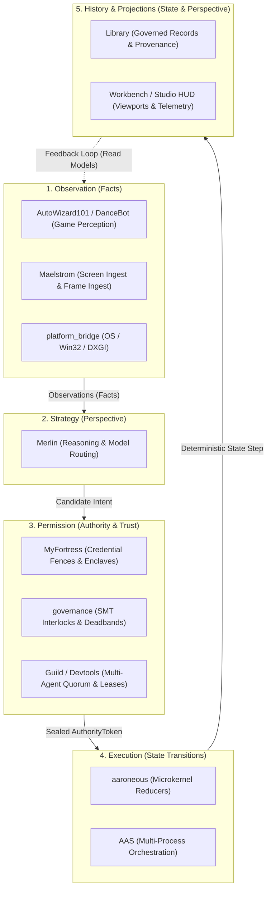

# Constellation Architectural Audit: Maximizing the Layer 0 Ontology

**Status:** Working Draft, Unreviewed (Companion to devtools PR #291)
**Author:** Gemini Seat (`aaroneous-gemini-seat[bot]`)
**Scope:** The Entire Aarogaming Ecosystem (12 repositories verified live via GitHub API on 2026-11-18)
**Date:** 2026-11-18
**Governing Documents:** [AGENTS.md](../AGENTS.md), [CRATIFY_SPEC.md](CRATIFY_SPEC.md), and [MASTER_ARCHITECTURE.md](architecture/MASTER_ARCHITECTURE.md). (Related draft: `docs/ATLAS.md` on PR #151).

---

## 1. Executive Thesis: The Universal Reality Model

Does the Layer 0 working ontology apply only to `aaroneous` and `aaroneous-devtools`?

**No. It applies conceptually across every repository, component, and subsystem in the Aarogaming constellation.**

The fundamental error in multi-repository development is treating each codebase as a separate architectural silo with its own bespoke reality model:
- Viewing a game agent as a "bot".
- Viewing an orchestrator as a "script runner".
- Viewing a model gateway as an "API wrapper".
- Viewing a catalog as a "database".

In reality, `[Hypothesized]` **every repository in the constellation operates as or supports an embodiment system**. The universal responsibility of an embodiment system is:

$$\text{Observe Environment (Facts)} \longrightarrow \text{Determine Permission (Authority)} \longrightarrow \text{Execute Step (Actions)}$$

### 1.1 The Non-Negotiable Separation Invariant
The foundational invariant identified across Maelstrom, Devtools, and Aaroneous is:

$$\mathbf{Facts} \neq \mathbf{Authority} \neq \mathbf{Actions}$$

1. **Facts Describe Reality**: Observation, ingestion, sensor capture, memory reads, telemetry. Facts answer *"what is"*. **Facts never authorize actions.**
2. **Authority Determines Permission**: Policy boundaries, interlocks, deadband thresholds, credential gates. Authority answers *"what is permitted"*. **Authority never executes transitions.**
3. **Actions Execute Transitions**: State reducers, input dispatches, kernel steps, network writes. Actions answer *"what happens next"*. **Actions never self-authorize; they strictly consume authority.**

---

## 2. Empirical Constellation Census (Observed 2026-11-18)

All metrics below are derived directly from authenticated recursive Git tree inspections via the GitHub API (`GET /repos/Aarogaming/{repo}/git/trees/{sha}?recursive=1`) executed across the `Aarogaming` organization on 2026-11-18. In Git object terminology, "Blobs" correspond to individual files, and "Trees" correspond to directories.

| Repository | Head Ref & Commit | Tree Entries | Blobs (Files) / Dirs | Top File Extensions (Count & %) | Verified Core Sources & Entrypoints |
| :--- | :--- | ---: | :--- | :--- | :--- |
| **`aaroneous`** | `main` @ `cc794cb3` | 1,346 | 1,094 files / 252 dirs | `.rs` (766, 70.0%), `.md` (125, 11.4%), `.json` (80, 7.3%), `.toml` (64, 5.9%) | `core/hypervisor`, `crates/compute`, `crates/governance`, `crates/wire`, `crates/ipc_bus` |
| **`aaroneous-devtools`** | `main` @ `a87ec8f2` | 598 | 487 files / 111 dirs | `.md` (119, 24.4%), `.json` (103, 21.1%), `.rs` (88, 18.1%), `.py` (72, 14.8%) | `foundation/crates/steward`, `foundation/crates/foundation_cli/src/guild.rs`, `scripts/merge_gate.py`, `gui/` |
| **`AaroneousAutomationSuite`** | `master` @ `4b52088a` | 6,669 | 6,254 files / 414 dirs | `.md` (2,486, 39.7%), `.json` (2,060, 32.9%), `.py` (1,105, 17.7%), `.meta` (185, 3.0%), `.cs` (79, 1.3%) | `fix_kernel.py`, `repair_kernel.py`, `plugins/architect.py`, `AAS_Launcher.bat` |
| **`Maelstrom`** | `main` @ `bb6e3608` | 2,073 | 1,728 files / 345 dirs | `.png` (325, 18.8%), `.py` (240, 13.9%), `.jpg` (168, 9.7%), `.cs` (152, 8.8%), `.json` (118, 6.8%) | `Client/merlin_overlay.py`, `minigames/dueling_diego.py`, `src/ProjectMaelstrom/Scripts/Library/Deimos-Wizard101/src/combat_cache.py` |
| **`AutoWizard101`** | `main` @ `5b5c2400` | 3,888 | 3,361 files / 527 dirs | `.png` (588, 17.5%), `.gif` (551, 16.4%), `.js` (388, 11.5%), `.py` (210, 6.2%), `.jpg` (168, 5.0%) | `DevTools/UiAuditRunner/Program.cs`, `HandoffTray/BotApiClient.cs`, template matching assets |
| **`Wizard101_DanceBot`** | `main` @ `ca0ec613` | 63 | 55 files / 8 dirs | `.py` (21, 38.2%), `.png` (18, 32.7%), `(no_ext)` (2, 3.6%), `.md` (2, 3.6%), `.ico` (2, 3.6%) | `dance_game.py`, `image.py`, `gui.py`, `main.py` |
| **`Guild`** | `main` @ `b3749df8` | 43,099* | 38,317 files / 4,775 dirs | `.txt` (20,232), `(no_ext)` (5,023), `.md` (3,110), `.py` (2,771), `.json` (2,278) | Multi-process tooling (`tools/maelstrom_ipc_tail.py`, `uaf/orchestrator.py`); *truncated at GitHub API cap; includes 1,966 blobs under `.venv_precommit/` |
| **`Merlin`** | `main` @ `191b9371` | 5,295 | 4,606 files / 689 dirs | `.json` (1,411, 30.6%), `(no_ext)` (1,134, 24.6%), `.timestamp` (530, 11.5%), `.d` (465, 10.1%), `.rmeta` (437, 9.5%) | Multi-stack reasoning engine (Electron JS, Kotlin Android/Desktop, Unity C#) |
| **`MyFortress`** | `main` @ `3a9b922f` | 383 | 350 files / 33 dirs | `.json` (238, 68.0%), `.py` (60, 17.1%), `.md` (34, 9.7%), `(no_ext)` (7, 2.0%) | `gateway/api/grpc_server.py`, `gateway/api/intelligence_routes.py`, `gateway/api/middleware.py` |
| **`Library`** | `main` @ `9ee5442d` | 340 | 282 files / 58 dirs | `.json` (112, 39.7%), `.md` (75, 26.6%), `.py` (63, 22.3%), `(no_ext)` (13, 4.6%) | `plugins/catalog/plugin.py`, `plugins/discovery_engine/plugin.py`, `scripts/aas_discovery.py` |
| **`Workbench`** | `main` @ `7df1b0ca` | 1,198 | 1,034 files / 164 dirs | `.py` (586, 56.7%), `.md` (88, 8.5%), `.json` (79, 7.6%), `.cs` (77, 7.4%), `.ps1` (52, 5.0%) | `Assets/asset_ingestion.py`, `Assets/asset_manager.py`, `Assets/license_consolidator.py` |
| **`AndroidApp`** | `main` @ `b68dbf35` | 328 | 249 files / 79 dirs | `.kt` (134, 53.8%), `.xml` (34, 13.7%), `.md` (30, 12.0%), `.json` (14, 5.6%) | `app/src/androidTest/java/com/aaroneous/AccessibilityChecksRule.kt`, mobile client interface |

---

## 3. Conceptual Constellation Matrix: Primitive Mapping

Every repository can be analyzed through the six Layer 0 primitives:

| Repository | Role in Constellation | Dominant Primitives | Invariant Responsibility & Contract |
| :--- | :--- | :--- | :--- |
| **`aaroneous`** | Execution Engine & Physical Microkernel | **State, Transition, Constraint** | Pure state reduction $S_{t+1} = f(S_t, I)$. Zero-allocation hot paths, flat Pod/Zeroable memory geometry. `[Hypothesized]` Consumes authority tokens to step physical runtime. |
| **`aaroneous-devtools`** | Autonomous Verification & Governance | **Trust, Relationship, Constraint** | Cryptographic review quorum (`ssh-ed25519`), multi-family model isolation, mathematical 3-way revert equality, append-only coordination ledgers. |
| **`AAS` (AutomationSuite)** | Multi-Process Pipeline Orchestration | **Transition, Relationship** | Coordinated execution across OS process boundaries. Coordinates multi-actor transitions without violating zero ambient authority. |
| **`Maelstrom`** | Embodiment & Low-Level Actuation | **State, Transition, Constraint** | Hardware perception, screen ingest, frame timing, input dispatch. Observes raw facts, consumes authority to execute physical inputs. |
| **`AutoWizard101` / `DanceBot`** | Target Environment Adapters | **State (Facts), Relationship** | Domain adapters. Ingests game memory and UI trees into typed fact structures. Facts describe reality; never self-authorize. |
| **`Guild`** | Multi-Agent Institution | **Trust, Relationship** | Trust applied to collective execution: peer admission, agent role assignments, reservation budgets, delegation graphs. |
| **`Merlin`** | Reasoning & Model Routing | **Transition (Proposals), Perspective** | Strategic hypothesis generation. Proposes candidate state transitions; never executes or authorizes them directly. |
| **`MyFortress`** | Credential Enclave & Security Boundary | **Constraint, Trust** | `[Hypothesized]` Trust applied to authority: cryptographic key fences, credential enclaves, zero ambient authority enforcement. Issues authority grants; never executes actions. |
| **`Library`** | Persistent Memory & Provenance | **State (History), Trust** | Trust applied to knowledge: immutable governed component records, historical decisions, dependency tracking, reproducible projections. |
| **`Workbench`** | Diagnostic Visualizer & Asset Catalog | **Perspective, State** | Read-only instrumentation, asset indexing, telemetry inspection viewports. Reads state; never performs state transitions. |
| **`AndroidApp`** | Mobile Client Adapter | **Relationship, Perspective** | Configured remote interaction boundary, lightweight mobile viewports without ambient host access. |

---

## 4. The Universal Architectural Topology

When the 12 repositories are mapped to the Layer 0 ontology, the conceptual relationships form a structured cybernetic cycle:



---

## 5. Concrete Anti-Patterns & Observed Technical Debt

Inspection of the repository trees reveals architectural friction where implementations deviate from the separation invariant:

### 5.1 `aaroneous` (Product)
- **Census Incompleteness**: `[Observed]` Only 3 crates (`core-contracts`, `governance`, `omni`) are audited in the initial ATLAS draft; 38 workspace members remain unaudited.
- **Ambient Time Coupling**: `[Observed]` Several components accept raw tick integers without explicitly separating monotonic sequence ordering (`Transition`) from duration/timeout policies (`Constraint`).
- **Raw Sensor Ingestion**: `[Observed]` `platform_bridge` captures raw DXGI/Win32 inputs; structuring these into formal, typed fact structures remains an ongoing evolution.

### 5.2 `aaroneous-devtools` (Tooling & Governance)
- **Ledger Conflation**: `[Observed]` `COORDINATION_QUEUE.md` conflates `State` (lane claim), `Transition` (git branch delta), and `Trust` (attestation receipts) into single markdown table rows.
- **Test Invariants**: Tests in `job_service.rs` correctly use explicit test variable injection (`DEVTOOLS_TEST_GIT`, `DEVTOOLS_TEST_SSH_KEYGEN`), but full hermetic virtualization of all sub-processes remains ongoing.

### 5.3 `Guild` & `AAS`
- **Vendored Dependency Bloat**: `[Observed]` `Guild` contains 38,317 checked-in blobs, including 1,966 files under `.venv_precommit/`, embedding third-party Python virtual environment artifacts directly into the git tree.
- **Authority Conflation in AAS**: `[Hypothesized]` Orchestration scripts (`AAS_Launcher.bat`, `fix_kernel.py`) mix process launch state with execution privileges, which risks violating zero ambient authority.

### 5.4 `Maelstrom` & `AutoWizard101`
- **Capability Coupled to Theme**: `[Hypothesized]` Minigame implementations conflate image matching (`Facts`) with input actuation (`Actions`).
- **Language Sprawl**: `[Observed]` `AutoWizard101` contains both C# UI runners (`DevTools/UiAuditRunner`) and Python bot runners without a formalized IPC contract between them.

### 5.5 `Merlin`
- **Client Duplication**: `[Hypothesized]` Separate client wrappers exist across JavaScript (Electron), Kotlin (Android & Desktop), Python, and C# (Unity), suggesting a duplicated reasoning protocol rather than a unified RPC contract.

### 5.6 `MyFortress` & `Library`
- **Data-Plane vs. Control-Plane Smear**: `[Hypothesized]` `Library`'s catalog plugins mix immutable governed component records with ephemeral operational discovery caches.

---

## 6. The 4-Pillar Universal Normalization Pipeline

To normalize all 12 repositories, we follow the **Wrap-First Doctrine**:

$$\text{Wrap} \longrightarrow \text{Observe} \longrightarrow \text{Measure} \longrightarrow \text{Extract} \longrightarrow \text{Normalize} \longrightarrow \text{Replace}$$

*Never Rewrite and Hope. Do Not Import Repositories; Import Discoveries.*

### Pillar 1: Universal Repository Census (`[Aspirational]`)
Extend Layer 0 reduction across every repository in the constellation:
- Every public component across all 12 repositories should be classified into its primary primitive:
  $$\text{Component} \in \{\text{State}, \text{Transition}, \text{Relationship}, \text{Constraint}, \text{Trust}, \text{Perspective}\}$$

### Pillar 2: Mechanize the Invariant via `ast_auditor` (`[Aspirational]`)
Enforce $\text{Facts} \neq \text{Authority} \neq \text{Actions}$ via compile-time AST verification:
- **Observation Purity**: Types in an observation module are banned from exposing direct actuation methods (`.execute()`, `.dispatch()`).
- **Authority Purity**: Governance types return non-forgeable `AuthorityToken` grants; they do not perform physical environment side effects directly.
- **Action Gating**: Execution methods must consume a valid `AuthorityToken`.

### Pillar 3: Decomposed Environment Interfaces (`[Hypothesized]`)
To prevent an environment adapter from self-authorizing, cross-environment interaction is decomposed into three distinct contracts:

```rust
/// Read-only observation stream. Cannot execute actions or mint authority.
pub trait FactSource {
    type Observation;
    type Error;

    fn poll_observation(&mut self) -> Result<Self::Observation, Self::Error>;
}

/// Execution sink. Requires a valid, unforgeable AuthorityToken minted by governance.
pub trait ActionSink {
    type Command;
    type Receipt;
    type Error;

    fn execute(
        &mut self,
        command: Self::Command,
        token: &core_contracts::AuthorityToken,
    ) -> Result<Self::Receipt, Self::Error>;
}
```

*The authority token itself is minted exclusively by `crates/governance` through a sealed constructor inaccessible to `ActionSink`.*

### Pillar 4: Pure Runtime Cryptographic Trust (`[Aspirational]`)
In accordance with AGENTS.md Section 4 ("Aaroneous never depends on external tooling"), the runtime microkernel does not depend on devtools scripts or external tooling formats:
- Dynamic configuration updates, mission boundaries, and model interventions carry pure Ed25519 signatures verified directly by `core-contracts` and `governance`.
- Build-time verification (`merge_gate.py`) and runtime governance share the same mathematical principles (Ed25519 cryptography, quorum thresholds) while remaining completely decoupled in implementation.

---

## 7. Success Criteria

Constellation normalization progresses as:
1. **Subsystems**: Every subsystem answers: *What primitive does this express?*
2. **Capabilities**: Every capability answers: *What evidence proves it works?*
3. **Authority**: Every authority boundary answers: *What permits this action?*
4. **Actions**: Every action answers: *What fact justified it?*
5. **Consolidation**: Repositories unify naturally because their underlying concepts have already converged into one reality model.
